# 快速开始

## 前置准备

### 关于Live2D

> [!IMPORTANT]
> 如确需使用Live2D，用户需自行向Live2D Inc. 获取Live2D的相应授权。Live2D模型的任何版权问题，以及任何的使用授权协议问题，需由用户自行承担。

Motori在缺失相应运行时文件时可正常运行，仅无法加载对应版本的Live2D模型。若您不需要相应的Live2D支持，请跳过本节。

Motori基于pixi-live2d-display-webgal框架进行Live2D模型的使用，同时支持Cubism 2.1与Cubism 3+模型。

Motori的发行版本中不提供Live2D Cubism 2.1 for Web运行时文件`live2d.min.js`。如确需使用，用户需自行获取该运行时文件以及相应授权，确保文件名正确，并将`live2d.min.js`置于Motori文件目录下的`/lib`目录之中。您可以在[此处](https://cdn.jsdelivr.net/gh/dylanNew/live2d/webgl/Live2D/lib/live2d.min.js)下载到该运行时文件。

Motori支持Live2D第三方运行时核心Sakura2D Purism Core，并在发布版本中默认提供其运行时文件`purismcore.js`。使用该运行时文件时，Motori支持Cubism3以上的Live2D模型的载入，但对于高于Cubism 4.0版本的特性可能无法完整支持。

### 关于立绘放置路径

Motori通过自身的虚拟文件系统进行立绘的路径表达、文件搜索与载入。详情请见 虚拟文件系统 章节。

您可以通过将常用的立绘放置在`/figure`目录下的方式进行使用，这将使得所有项目都能加载对应的立绘文件（除非优先级更高的目录下存在同名文件）。但出于项目管理上的考虑，我们更推荐您直接通过将您的视觉小说项目中的、引擎扫描时的对应类型资源根目录添加为Motori项目的“资源目录”的方式使用立绘文件。我们不建议您混用这两种管理方式。

## 启动

Motori为WebUI程序。运行主程序后，其将启动一个使用5270端口的Web服务器，并在浏览器中打开[http://localhost:5270/](http://localhost:5270/)页面。

同时仅能有一个Motori后端主程序进程处于运行状态。重复运行时仅会重新打开一个使用原后端主程序的新的浏览器页面。若5270端口被其他程序占用，Motori将无法运行。

您在使用过程中可以打开任意数量的Motori网页，互不影响。**但请避免多个页面打开同一个Motori项目，这将造成编辑冲突问题。**

使用过程中请务必保证Motori后端主程序进程始终处于运行状态。关闭或重启将导致已经打开的页面无法继续使用。

## 新建会话或打开项目

进入Motori页面后，您首先需要新建一个会话，或选择一个本地既存的项目进行载入。

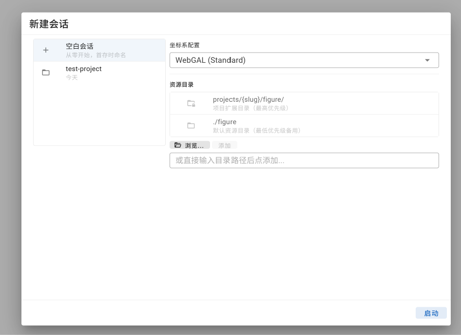

### 新建会话

在左侧的会话列表中选择“空白会话”可以新建一个空白会话。

#### 坐标系

您需要在“坐标系选择”下拉框中选择一个与您的目标引擎相适配的坐标系配置方案。错误的坐标系配置将导致Motori中的画面大小、立绘位置、尺寸、锚点等无法与目标引擎吻合，无法达成一致的视觉效果。

坐标系配置仅能在新建空白会话时进行选择，项目创建后将无法修改。

#### 资源目录

Motori在资源目录列表中，按照从上到下的优先级顺序进行文件的扫描与匹配。详情请见 虚拟文件系统 章节。

您可以点击“浏览”选择一个本地的资源路径进行添加。您也可以直接粘贴路径到下方文本框中，然后点击“添加”按钮进行路径的添加。

您可以上下拖动资源路径项，进行优先级的调整。Motori目录下的`/figure`目录将始终保持最低优先级，作为回退选项存在。

需要注意的是，在项目创建后，已添加的资源目录将被锁定，无法移除或进行优先级调整。

> [!NOTE]
> 若您的目标引擎是WebGAL，推荐您添加对应游戏项目中的`\game\figure`和`\game\background`目录（顺序分先后）。
>
> 若您的目标引擎是RenPy，推荐您直接添加对应游戏项目中的`\game`目录。

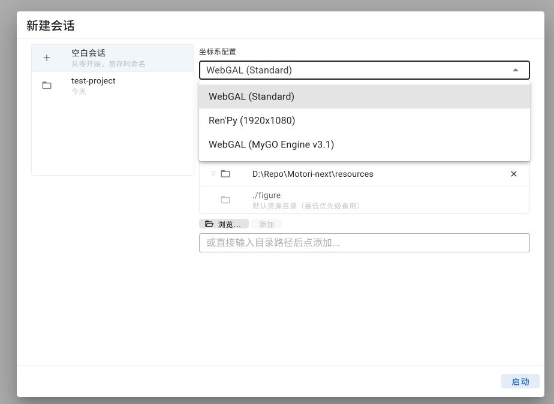

### 打开既有项目

在左侧的会话列表中选择一个既存项目以进行加载。

这将会显示项目的名称、路径、坐标系、最后保存日期、资源目录等信息。

既存项目无法修改坐标系，也无法修改已有的资源目录。但您仍可以追加选择新的资源目录，其优先级将固定低于已有资源目录，但高于默认资源目录`/figure`，且目录项无法拖拽。

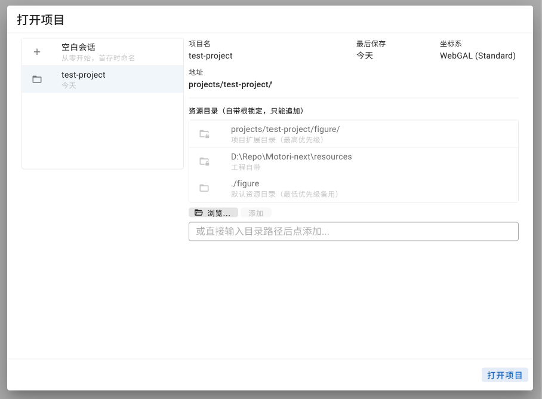

## 加载第一个立绘

右上角选择“全局设置”选项卡，使右侧的主编辑器进入全局设置页。随后点开“项目”部分的“立绘管理”选项卡。

在立绘树中，虚拟根对象`(root)`，以及所有的容器对象，均具有立绘导入按钮(<i-mdi-import/>)，可以在其上创建一个新的容器或挂载一个新的立绘。

点击虚拟根对象`(root)`的立绘导入按钮(<i-mdi-import/>)，打开“导入立绘”对话框。“立绘类型”中选择“图像立绘”或“Live2D立绘”选项卡，点击“文件路径”下的文本框，打开“选择文件”对话框，在其中找到需要加载的立绘文件。单击可以选中文件或文件夹，双击文件夹、或选中后点击“打开”，进入文件夹之中；双击“..”，或选中后点击“打开”，返回上级目录；双击文件，或选中后点击“确认”，确认选中对应文件。

在“ID”中填写立绘的ID，该ID需与你在目标视觉小说引擎中将要为其使用的ID相匹配。立绘名暂时无法独立编辑。若是图像立绘，您还需要选择其类型为“立绘”还是“背景”，其在对应的坐标系定义、以及导出指令上可能存在不同。

完成后，点击“导入”，即可将立绘加载到舞台之上。

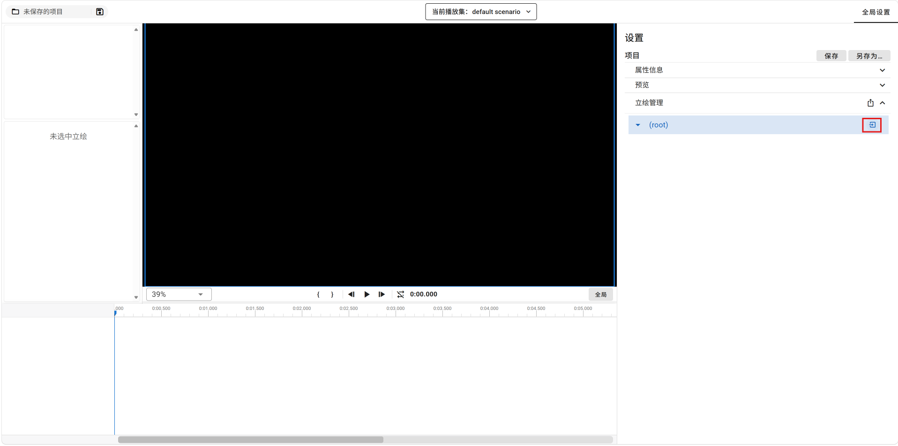

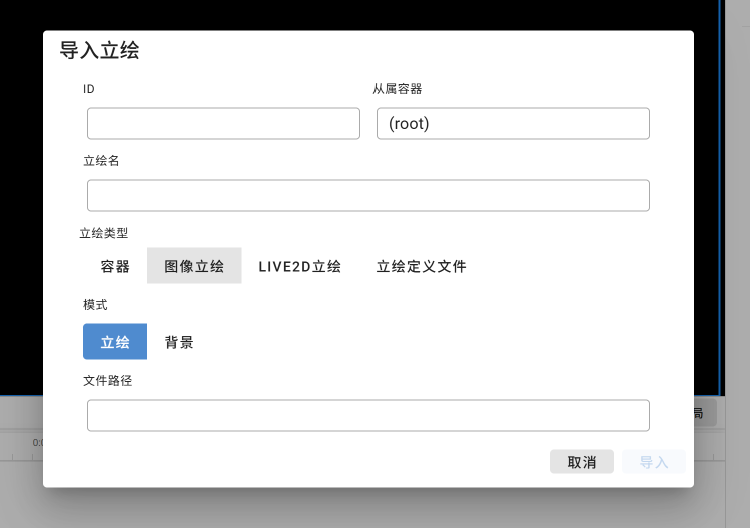

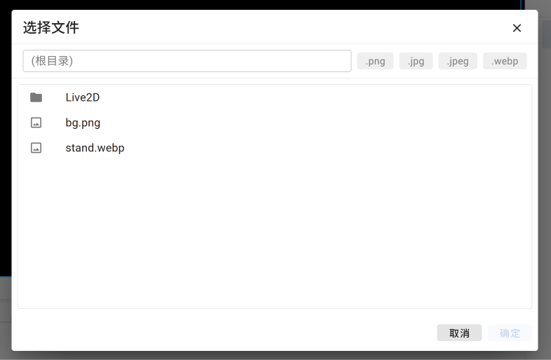

## 选择立绘

您能够以下述方法选中一个立绘：
1. 在页面左上角的立绘列表中点选立绘。当前选中的立绘项将以蓝底高亮显示。点击容器立绘的三角标记可以展开或折叠容器。
2. 在时间轴中点选立绘行的标头部分。当前选中的立绘项将以蓝底高亮显示。点击容器立绘的双箭头标记可以展开或折叠容器。
3. 直接在舞台上单击选择立绘。

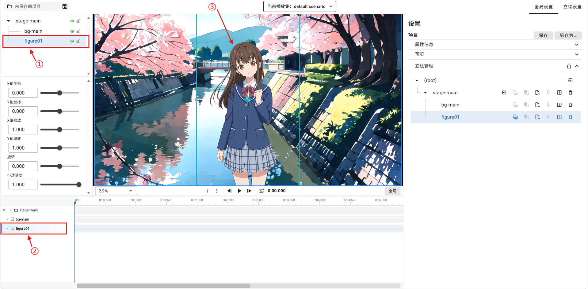

## 保存项目

页面左上角显示了当前打开的项目名称。

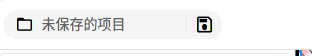

若当前为尚未保存过的新建项目，项目名称将显示为“未保存的项目”，且左侧文件夹图标(<i-mdi-folder-outline/>)将显示为灰色。点击保存按钮(<i-mdi-content-save-outline/>)将弹出“保存项目”对话框，输入一个与当前已有项目不重复的名称后点击“保存”即可。

若当前为已存在的项目，点击保存按钮(<i-mdi-content-save-outline/>)即可进行保存。项目的保存可能需要一定的时间。此外，将额外显示另存为按钮(<i-mdi-content-save-plus-outline/>)，点击后将弹出“另存为”对话框，输入一个与当前已有项目不重复的名称后点击“另存为”即可。

## 创建自定义Live2D动作与表情

> [!IMPORTANT]
> 本章后续内容主要介绍变换系统的使用。Live2D自定义动作与表情的编辑具有较高的系统与流程独立性，在此不做介绍。
> 
> 若您暂时仅需新建Live2D动作与表情，而无需进行视觉小说演出编排，您可以暂时跳过本章的后续部分。

详情请见 章节。

## 尝试调整一个立绘的当前变换属性

首先，选中一个目标立绘。然后，您将可以通过以下方式对立绘的当前变换属性进行修改。

1. **在舞台上直接进行拖拽编辑。**

    当一个立绘被选中时，舞台上将会显示保卫该立绘的选框，锚点位置，以及控制柄。
    
    您可以直接通过拖拽立绘来调整其位置，通过灰色控制柄调节立绘的X、Y轴缩放倍率，通过黄色控制柄调节立绘的旋转弧度。
    
    您无法通过该方式调节立绘的不透明度。

2. **通过左侧的当前值小组件进行控制。**

    当前值小组件将显示选中立绘的当前坐标、X/Y轴缩放、旋转弧度以及不透明度。
    
    您可以直接在文本框中输入、修改这些属性参数，也可以通过滑条进行控制。其中，旋转与不透明度属性的滑条为绝对值式的；而X/Y轴坐标与X/Y轴缩放的滑条为相对控制柄，通过侧拉的幅度控制数值增减的速度。

3. **通过立绘编辑器的“当前值”选项卡进行控制。**

    右上角选择“立绘设置”选项卡，使右侧的主编辑器进入立绘设置页。点击打开页面中的“当前值”选项卡。其操作方式与当前值小组件相同。

4. **通过编辑初始变换、基线帧、变换帧间接控制。**

    对当前值的编辑，将根据当前播放头所在时间点、变换帧状态而最终被写入到对应的初始变换、基线帧或变换帧之中。反过来，对初始变换、基线帧或变换帧的调整，也将间接影响立绘的当前属性值。

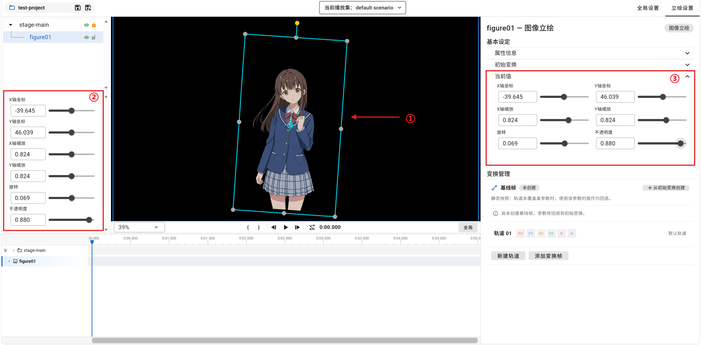

## 尝试创建一个变换帧

在立绘主编辑器的“变换管理”区域，点击“添加变换帧”，在当前时间点创建一个变换帧。然后，在下方的帧列表中点击展开你刚刚创建的这个变换帧。

尝试为各个参数赋值，以及点击清除按钮(<i-mdi-close/>)清除对应参数值。

尝试修改设定时长、以及过渡算法。

尝试通过起始时间控件上下的箭头调节变换帧的起始时间。

每次调整后，前后拖拽时间轴的播放头，查看改动造成的影响。

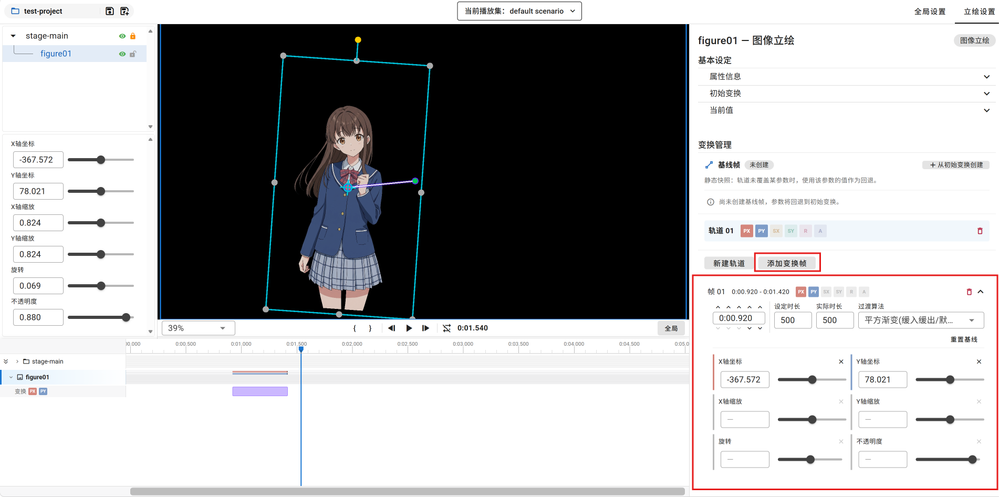

## 尝试创建Live2D动作帧与表情帧

选中一个Live2D立绘，页面右上角选择“Live2D设置”选项卡，进入Live2D主编辑器。

点击“关键帧”标题栏右侧的添加按钮（<i-mdi-plus/>），创建一个空帧。在下方的帧列表中，点击选择对应的动作或表情。

调整后，前后拖拽时间轴的播放头，查看改动造成的影响。

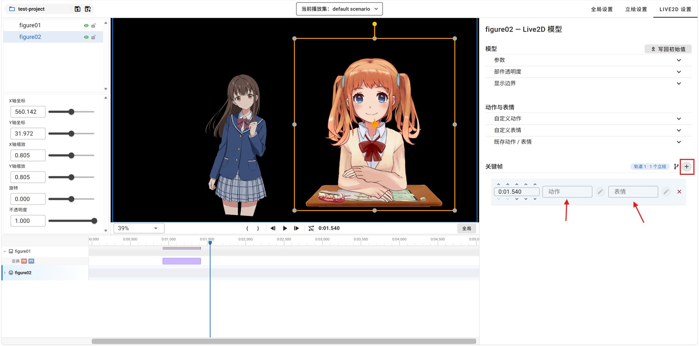

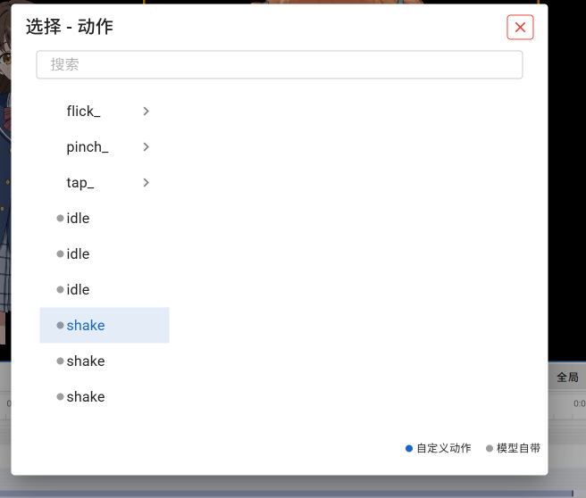

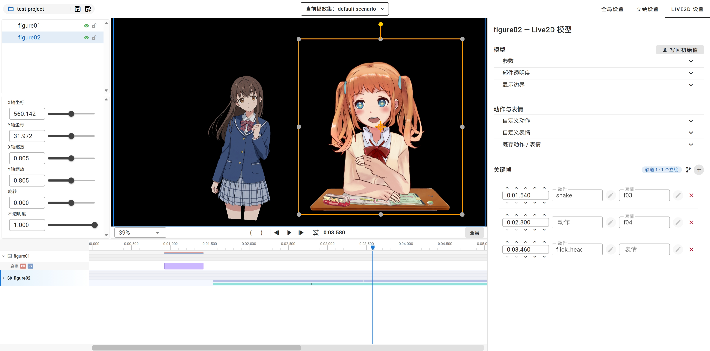

## 时间轴

您可以通过时间轴系统控制播放，查看帧的覆盖情况，以及进行快速的调整。

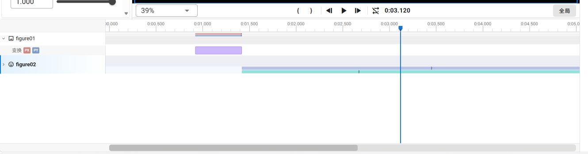

### 播放控制栏

您可以通过播放栏左侧的缩放比例控制器调整舞台的缩放比例。

播放栏中部的按钮分别为：
- 入点（ { ）（快捷键：I）
- 出点（ } ）（快捷键：O）
- 左移一个刻度（<i-mdi-step-backward/>）（快捷键：方向左键）
- 播放/暂停（<i-mdi-play/>/<i-mdi-stop/>）（快捷键：空格）
- 右移一个刻度（<i-mdi-step-forward/>）（快捷键：方向右键）
- 循环播放控制（<i-mdi-repeat-off/>/<i-mdi-repeat/>）（快捷键：R）

### 缩放控制

拖拽下方的滚动条可进行时间轴的横向滚动。拖拽下方滚动条的左右边缘控制柄可以控制时间轴的横向缩放。

时间轴无法进行纵向缩放。

鼠标在时间轴区域内滚动滚轮，可进行时间轴的纵向滚动；若滚动同时按住Shift键，可进行时间轴的横向滚动；若滚动同时按住Ctrl键，可进行时间轴的横向缩放，该操作优先级高于滚动。

### 泳道

时间轴中立绘的标头所在行显示有一系列的泳道。其从上到下分别为：
- 坐标X轴
- 坐标Y轴
- 缩放X轴
- 缩放Y轴
- 旋转
- 不透明度
- 透视相机（仅挂载透视相机时显示）
- Live2D动作（仅Live2D立绘显示；轨道展开时隐藏）
- Live2D表情（仅Live2D立绘显示；轨道展开时隐藏）

### 变换轨道

点击立绘标头处的单箭头，可以展开显示其拥有的变换轨道。

您可以通过拖拽快速调整变换帧、动作帧、表情帧的位置。

您可以通过拖拽变换帧左缘、右缘的控制柄，快速调整变换帧的长度。

您可以通过双击在鼠标所指向的时间点快速创建变换帧、动作帧、表情帧。

您可以通过Del键或退格键删除当前选中的变换帧、动作帧、表情帧。

您可以通过按住Ctrl键或Shift键，或是鼠标框选，同时选中多个帧并进行批量操作。

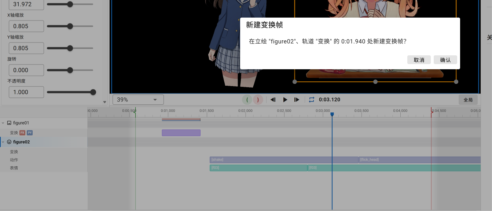

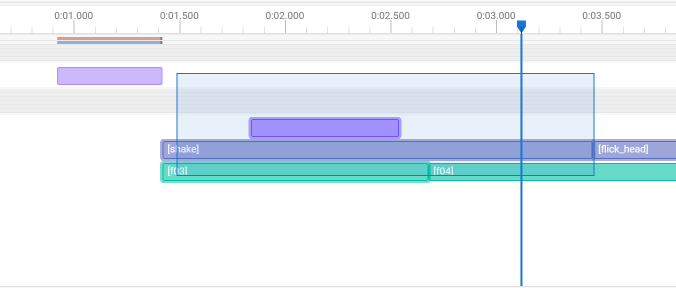

## 生成指令

先使用“入点”与“出点”节选需要导出指令的片段。

右上角选择“全局设置”选项卡，使主编辑器进入全局设置页。

选择“立绘管理”选项卡标题栏处的“编译变换指令”按钮（<i-mdi-export-variant/>），打开“编译变换指令”对话框。

在左侧的立绘列表中选择需要生成指令的立绘。若要取消选择，您需要先选中该立绘、使其被标注为“当前”，然后再次点击以取消选择。

在“插件”中选择您的目标引擎。当前Motori提供WebGAL与Ren'Py编译插件。

在“指令范式”中根据您的需要进行选择，然后点击“生成”，产生相应的指令。点击“复制”可将指令复制到剪贴板。

> [!WARNING]
> 对于“变换序列”选项，无论是哪个插件，我们均假定，**参与变换的所有立绘均已提前登场、并不通过这些指令入场。**
> 
> 因而，“变换序列”选项必须配合“仅登场”/“仅初始登场”等选项、或是您自己手写的相应指令使用。

> [!WARNING]
> 各个引擎的具体的指令生成范式、以及使用注意事项有所不同，请参考对应引擎的使用范式指南文档进行使用。

