# Live2D / 自定义动作与表情 / 快速开始

> [!WARNING]
> 强烈建议您使用Live2D Inc. 官方的Live2D Cubism Editor进行相应的动作与表情制作。

> [!WARNING]
> 在开始前，您应当确保获取了所需的Live2D使用授权，以及涉及到的Live2D立绘的相关权益。使用过程中产生的任何可能的商业授权问题与所有权问题，产生的任何版权问题，需由用户自行承担与处理。

## 创建空动作与空表情

选择一个Live2D立绘，页面右上角选择“Live2D设置”选项卡，进入Live2D主编辑器。

在“动作与表情”区域，点击展开“自定义动作”或“自定义表情”选项卡，点击“<i-mdi-file-plus-outline/>新建”按钮，在弹出的对话框中输入名称，完成一个新的自定义动作或自定义表情的创建。

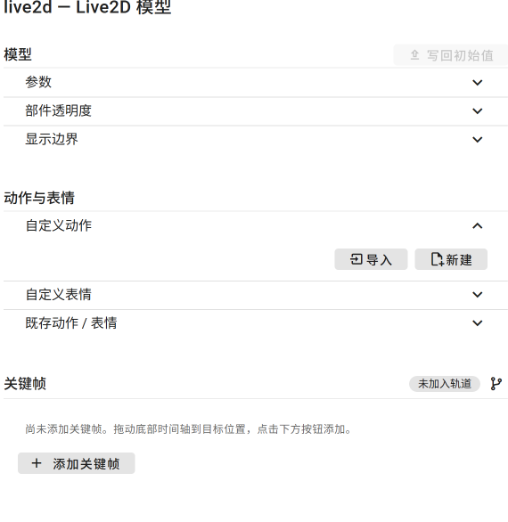

## 编辑自定义动作

在自定义动作列表中，点击需要编辑的动作项的“进入动作编辑器”按钮（<i-mdi-arrow-right-bold-outline/>），进入编辑编辑器。

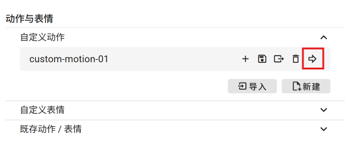

**动作编辑器内部使用与外界不同的时间单位。** 外部使用分-秒-毫秒的时间标识体系；但在Live2D动作内部，我们使用“帧”作为基本的时间单位。

自定义动作的帧率默认为30FPS；当前暂时不开放帧率的调整功能。

通过编辑动作时长，可以调整动作的总帧数；时长单位同样为帧，取值必须为整数。

点击右上角除“Live2D动作”与“高级参数”之外的选项卡，可以退出动作编辑器、结束动作编辑。

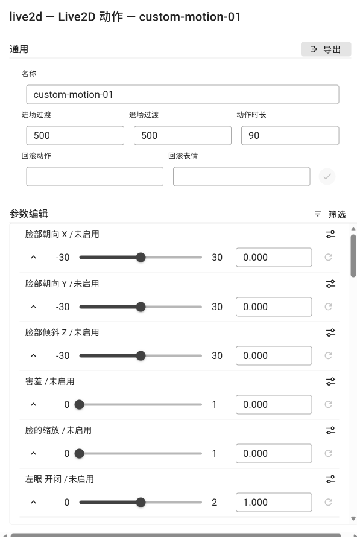

### 尝试最简单的编辑

选择一个未启用状态的参数，直接拖拽对应的滑条，或是在文本框中直接赋值。可见参数名一栏变为绿色、提示类型变为“固定值”，参数发生变化，Live2D立绘随之变化。

点击重置按钮（<i-mdi-refresh/>），参数回归初始值，状态被清除，从“固定值”变回“未启用”。

尝试一下，查看改动造成的影响。

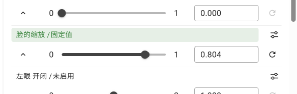

### 展开参数

选择一个参数，点击其展开/折叠按钮（<i-mdi-chevron-up/>），展开参数详情；展开时，按钮变为（<i-mdi-chevron-down/>）形，再次点击可以重新折叠参数。

参数处于折叠状态时，点击参数标题栏也可以展开参数；展开态下点击参数标题栏将会进入高级编辑器。

状态为“未启用”时，样式如下所示：

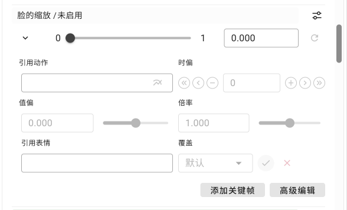

状态为“固定值”时，样式如下所示：

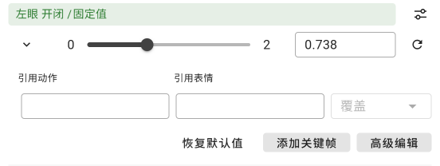

### 引用动作模式

对于一个不处于“关键帧动画”模式的参数，展开后点击“引用动作”，选择一个动作，可使该参数切换到“引用动作”模式。

该模式下，该参数将引用继承所选动作的参数曲线。

该模式下禁用直接的参数值编辑，滑条和参数文本框处于只读、禁用状态。

可以通过“时偏”、“值偏”、“倍率”三个选项进行调节。

- **时偏：起始帧（即本动作的第0帧）对应的，被引用的原始动作的帧号。** 即，当时偏为5时，本动作的第0帧对应被引用动作的第5帧，即被引用动作曲线向左偏移5帧；反之亦然。
- **值偏：在被引用的原始动作参数曲线的基础上的偏移值。**
- **倍率：在被引用的原始动作参数曲线上乘以的倍率值。**

倍率与值偏按照（原始值*倍率+值偏）的方式进行叠加运算。

点击“固定当前值”，将取当前的实时值，切换成固定值模式。

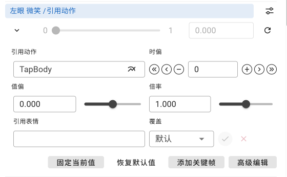

### 回滚动作与回滚表情

若当前存在选中的“回滚动作”或“回滚表情”，则当前处于 **未启用** 状态的参数将按照回滚动作、回滚表情中的对应参数的效果进行实时的展示；涉及到的参数将标注“回滚动作”与“回滚表情”提示。

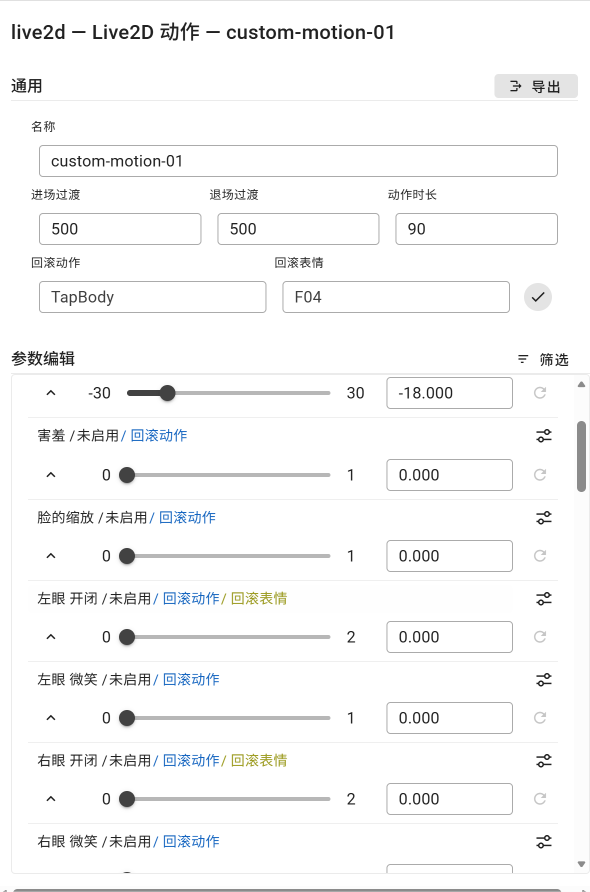

此时展开参数的显示效果如下所示。

点击“应用当前值”，将取当前的实时值，切换成固定值模式。

点击“应用预设”或“应用动作与表情预设”（<i-mdi-check/>），将应用当前的引用动作与引用表情效果。

若被回滚动作控制，则编辑“时偏”、“值偏”或“倍率”将使参数切换到引用动作模式，应用当前的引用动作，并丢弃引用表情，

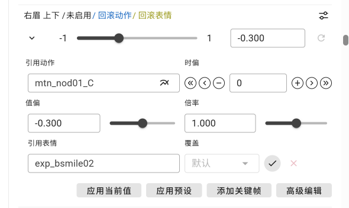

可以通过点选“通用”部分的，回滚动作与回滚表情所在行的“<i-mdi-check/>”按钮，批量应用当前的回滚动作与回滚表情效果。

### 引用表情

当参数上不存在引用动作时，选择引用表情，将使参数切换到固定值模式，直接应用对应的表情值。

当参数为引用动作模式时，选择引用表情，将临时性覆盖该参数的“值偏”与“倍率”属性，抑或是在该表情参数为模式、或手动将“覆盖”选项设为“覆盖”时完全覆写为表情对应的固定值。此时，点击“应用表情预设”（<i-mdi-check/>），将应用当前的引用表情效果，正式修改该参数的“值偏”与“倍率”属性，抑或是切换到固定值模式、设为对应的固定值。点击“放弃表情预设”（<i-mdi-close/>），将清除对应的应用表情效果，恢复引用动作的原效果。

当参数为初始值模式、且由回滚动作接管时，无论是否受引用表情影响，选择引用表情，将使参数切换到“引用动作”模式，并设置对应的引用表情，不会直接应用对应的表情。但是，直接点击“应用动作与表情预设”（<i-mdi-check/>）时，回滚表情效果将直接被应用，不会经过引用动作+引用表情的过渡状态。

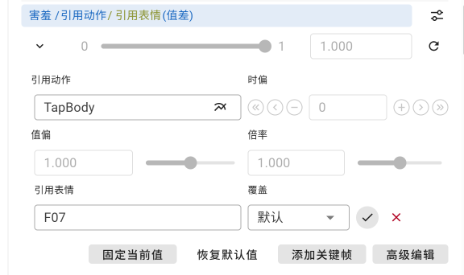

### 关键帧动画

点击“添加关键帧”，可以在当前时间点创建新的关键帧。若当前参数不处于关键帧动画模式，则参数还将同时切换到关键帧动画模式、并在第0帧位置创建一个新的关键帧。

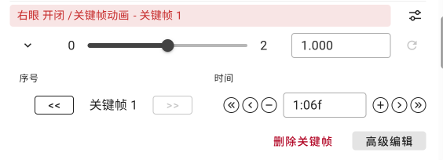

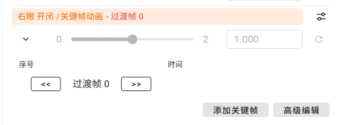

可以通过“序号”栏的左右箭头键快速切换关键帧。

仅关键帧上可以进行参数值的编辑。

当前时间落在关键帧上时，将显示“时间”控件，可通过其调整关键帧的所在时间。

特别的，如果是从引用动作模式创建的关键帧，创建的将是特殊的“引用帧”。与引用动作模式类似，该类型关键帧将引用继承所选动作的参数曲线片段。其属性定义与引用动作模式相同。

引用帧将锁定与其紧邻的下一关键帧/引用帧的值或值偏，确保下一关键帧始终落在对应的引用曲线上。

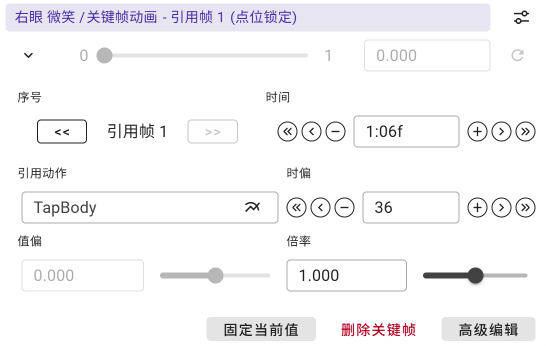

位于第0帧的关键帧仅能在该参数无其他关键帧存在时被删除；删除后，该参数将退回未启用模式。

### 时间轴

动作编辑器内部拥有独立的动作时间轴样式，其与全局时间轴有所差异，但在基本操作上大体相同。

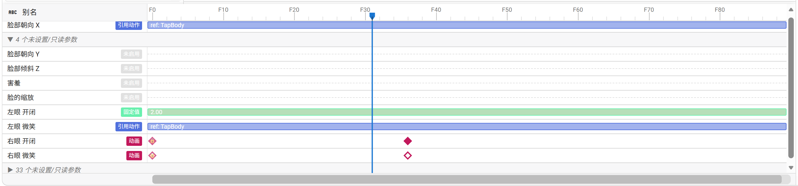

动作时间轴使用帧作为时间单位。入点与出点功能被禁用。

未启用参数通过一条轨道中心的灰色虚线进行标识。固定值和引用动作类型参数通过贯穿轨道的绿色/蓝色矩形长条进行标识，并标注对应的数值和动作名。

未启用参数默认被折叠显示。

动画模式参数将显示菱形标识的关键帧，其中空心关键帧图样表示引用关键帧。位于第0帧的关键帧不可选中、不可拖拽。其余关键帧可进行类似于全局时间轴的框选、多选、拖拽、删除操作。

双击动画模式参数轨道可以创建关键帧。该操作对非动画类型参数轨道无效。

### 进入高级编辑器

高级编辑器用于对动作的一个特定参数进行专注的编辑。

您可以通过以下方式进入高级编辑器。

1. 点击对应参数的高级编辑器图标（<i-mdi-tune-variant/>）；
2. 参数展开状态下点击“高级编辑”按钮；
3. 参数展开状态下点击参数标题栏；
4. 在时间轴上点击参数行的标头部分；当前选中的参数项将以蓝底高亮显示；

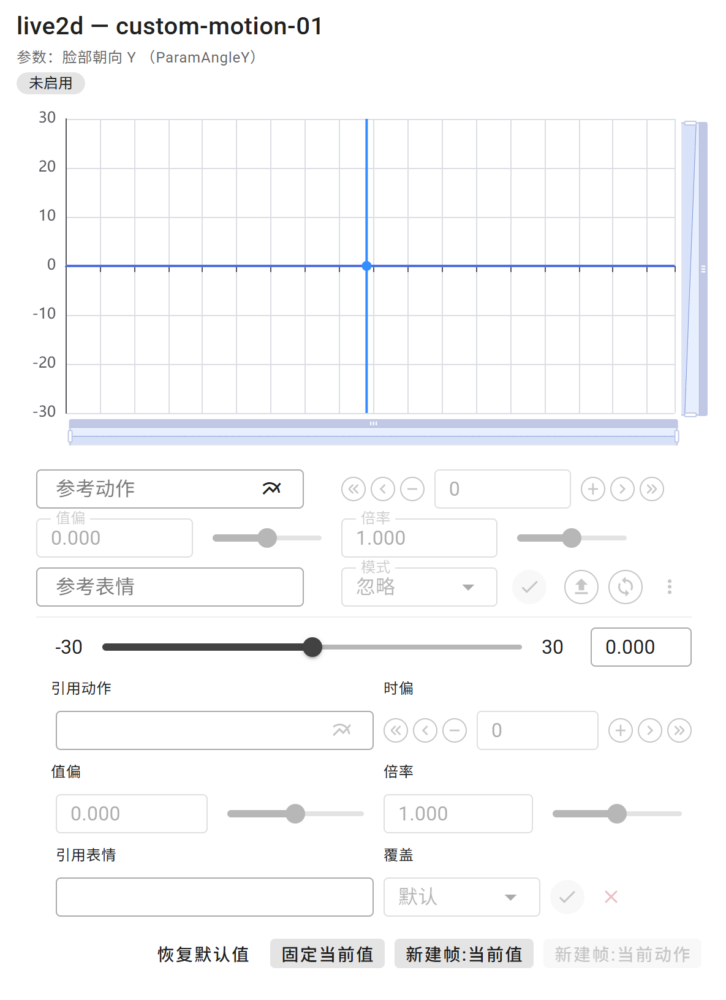

对于非关键帧动画模式的参数，其高级编辑器的下半部分，与动作编辑器展开参数时类似。

点击右上角“Live2D动作”选项卡，可以退出高级编辑器、返回动作编辑器；点击其他选项卡将直接退出动作编辑模式。

### 图表与参考曲线

高级编辑器中存在一张参数曲线图表，展示当前参数的数值曲线信息。

蓝色竖线为当前帧，蓝色圆点为当前实际数值，而蓝色曲线则表示实际设置的动作曲线。

参数处于未启用状态、且存在回滚表情时，或参数处于引用动作模式、且存在引用表情时，图表中会显示一条灰色曲线，表示未受该表情影响的原曲线。

调整各参数，尝试观察变化。

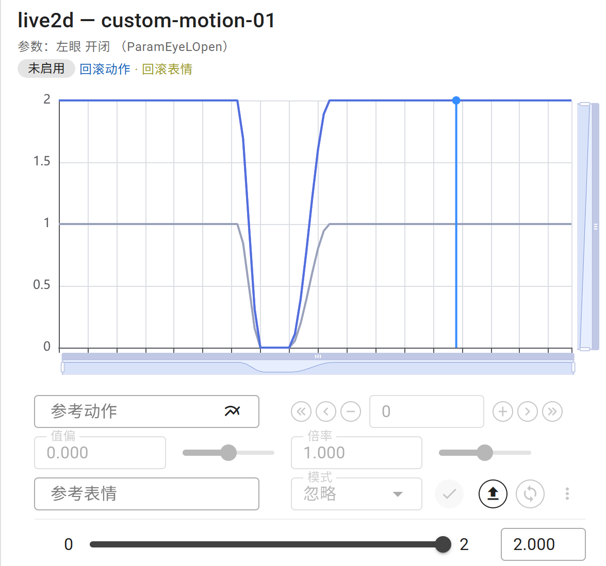

您可以选择参考动作与参考表情。

启用参考动作时，图表中将额外显示一条淡紫色曲线，展示你所选择的、跌价上对应的时偏、值偏、倍率后的参考动作曲线，

启用参考表情时，根据所选模式的差异，参考动作的值偏或倍率将被覆写，或直接被覆写成固定值，对应的淡紫色曲线变为覆写后状态；覆写前的曲线将以淡粉色曲线显示。对应的模式根据对应参考表情参数的类型进行默认赋值，可手动更改模式。

仅参考表情、无参考动作时，参考表情以对应的参数初始值作为偏移运算基准。

点击“<i-mdi-check/>”，可正式应用参考表情对值偏或倍率的覆写；点击“<i-mdi-upload/>”，可将当前引用动作参数载入成参考动作及其参数；点击“<i-mdi-sync/>”，可实际应用当前参考曲线（淡紫色曲线）。

在非关键帧动画模式下，实际应用参考曲线时，若存在参考动作、且参考表情非覆写模式，则为切换到引用动作模式，应用对应的引用动作和参数；若不存在参考动作、或参考表情为覆写模式，则切换到固定值模式，使用参考曲线对应的固定值。

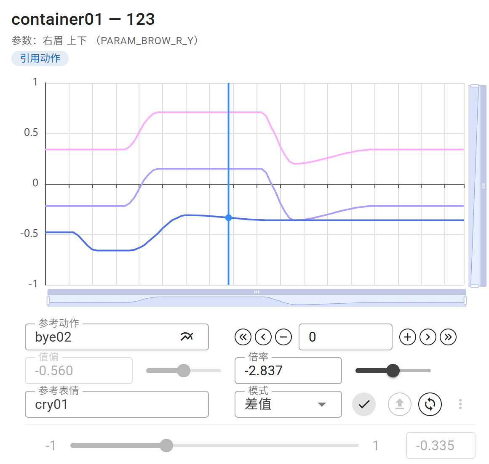

### 关键帧动画模式下的高级编辑器

关键帧动画模式下，高级编辑器的样式存在较大差异。

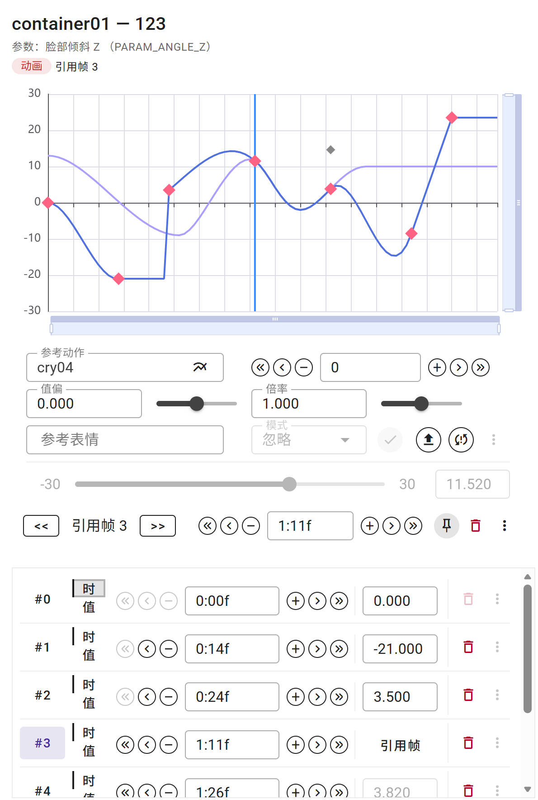

#### 图表

关键帧动画模式下，图表中额外显示关键帧图标（橙色）。对于被前一引用帧锁定位置的关键帧，将以灰点显示其被锁定前的原取值。

关键帧可直接拖拽编辑。其中，被锁定状态的值帧，以及引用帧，在单帧拖拽时仅能改变时间，而无法改变取值、Y轴方向无法拖拽。

可用鼠标框选多个关键帧。此时将显示选框及控制柄，可以批量拖拽关键帧，或是批量调节关键帧的间距比例和振幅比例。

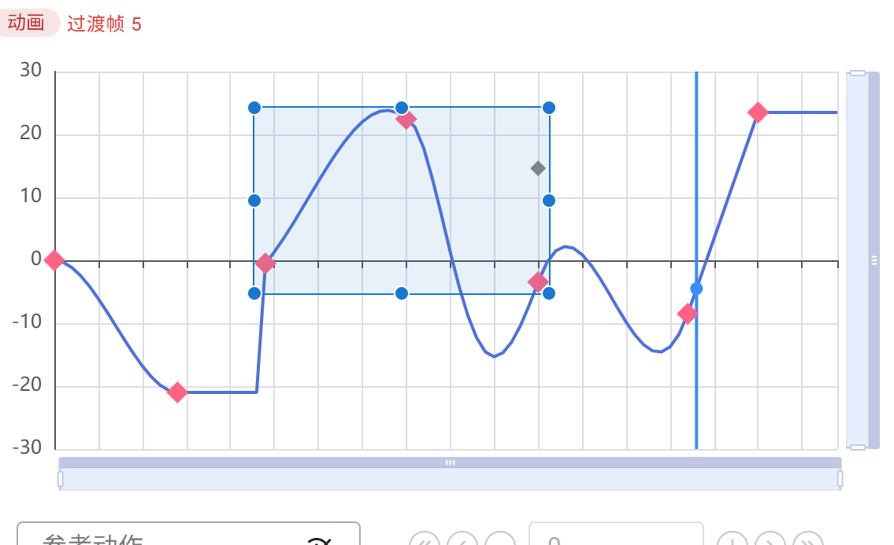

#### 参考曲线的同步

当存在参考曲线时，若当前时间无关键帧，或关键帧（若被前一帧锁定，则为原取值，即灰点）未落在参考曲线上、且不是引用帧，此时点击同步按钮（<i-mdi-sync/>），将同步当前关键帧的值为曲线当前值、使其落在曲线上；若无关键帧，则创建对应关键帧。若关键帧已经落在参考曲线上，或关键帧为引用帧，则此时同步按钮的图标将变为“<i-mdi-sync-alert/>”，此时点击同步将使该关键帧变为引用帧、并继承参考曲线的相应配置。

当前帧为引用帧时，点击“<i-mdi-upload/>”，可将当前引用帧载入成参考动作及其参数。

参考曲线与引用帧的时偏基准不同，同步与反载过程中将进行对应的换算转换。

此外，在当前帧为引用帧时，额外显示“<i-mdi-pin/>”图标，点击该按钮会将引用帧转化为值帧。

#### 关键帧列表

关键帧模式下，下方功能区将变为关键帧列表。

关键帧序号一栏可点击，点击后将快速跳转到对应的关键帧所在时间。

“时/值”选项卡可点击切换。

时模式下，鼠标移动到引用帧的“引用帧”提示上时，会浮动显示其对应参数；点击会将该引用帧反载到参考动作。

切换到值模式后，可修改关键帧的过渡类型。

自行尝试相应功能。

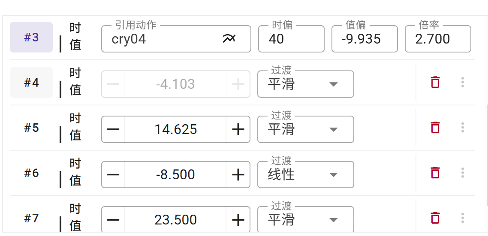

### 导出

在动作编辑器页点击“导出”按钮，弹出动作导出对话框。点选需要写入到动作文件中的参数，然后点击“导出”，浏览器将弹出对应的.mtn/.motion3.json格式动作文件的下载请求。

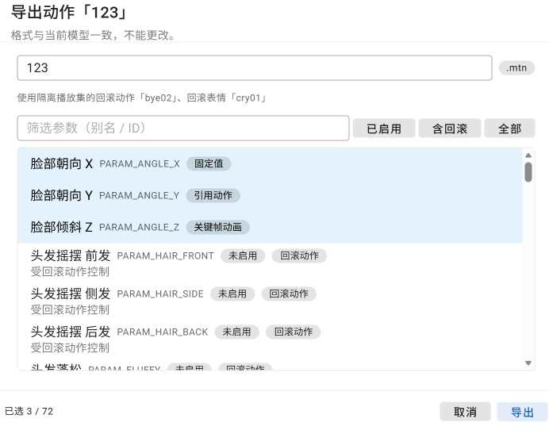

## 编辑自定义表情

在自定义表情列表中，点击需要编辑的表情项的“进入表情编辑器”按钮（<i-mdi-arrow-right-bold-outline/>），进入表情编辑器。

与动作编辑器不同，表情编辑器无独立的时间轴样式，不采用独立的时间单位。

点击右上角除“Live2D表情”之外的选项卡，可以退出表情编辑器、结束表情编辑。

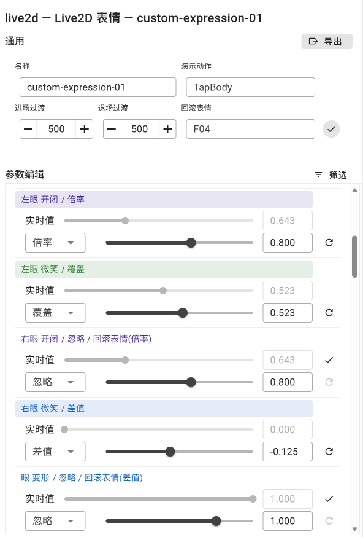

### 表情参数

Live2D参数取值计算的应用顺序为 动作 -> 表情 -> 物理，即，表情是一个叠加在动作曲线之上的修正量。

表情参数具有四种混合模式：
- 忽略：即不启用该表情参数。
- 覆盖：该Live2D参数将被覆写为表情设定的固定值；默认值为0。
- 差值：该Live2D参数将被固定加减表情设定的差值；默认值为0。
- 倍率：该Live2D参数将被固定乘以表情设定的倍率值；默认值为1。

通过下拉框可以在各混合模式间进行切换。每种模式的参数值是独立维护、互不影响的。

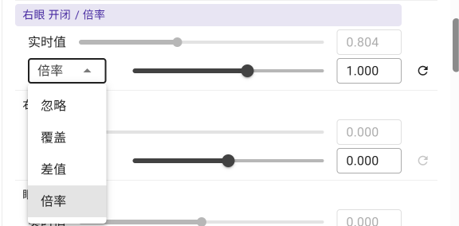

每个表情参数项具有两套数值指示器。下方的滑条-文本框组合，显示的是当前该表情参数的参数值，允许编辑。上方的滑条-文本框组合，显示的是当前该Live2D参数的实际实时值，不可编辑。

点击“<i-mdi-refresh/>”，将复位当前表情参数值到默认值。该操作仅还原当前选择的混合模式的参数值、不影响其他混合模式，且不会改变当前的混合模式。

“忽略”模式下，显示的参数值为默认混合模式下的参数值，且编辑参数值将使该参数切换到对应的默认混合模式。

仅对于左右眼开闭参数（`PARAM_EYE_L_OPEN`, `PARAM_EYE_R_OPEN`, `ParamEyeLOpen`, `ParamEyeROpen`），默认混合模式为“倍率”。对于其他参数，默认混合模式均为“差值”。

### 回滚表情与演示动作

若当前存在选中的“回滚表情”，则当前处于 **忽略** 状态的参数将按照回滚表情中的对应参数的效果进行实时的展示；涉及到的参数将标注“回滚表情”提示。

同时，相应参数将额外显示“<i-mdi-check/>”按钮，点击将固化应用对应的回滚表情混合模式与参数值。

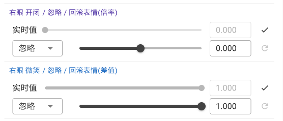

与自定义动作不同，自定义表情中没有“回滚动作”，但具有一个“演示动作”选项。演示动作用于展示、调整当前的自定义表情配置在实际与各个既存动作叠加时的实际效果，并非自定义表情的一部分，无法应用到自定义表情的参数配置之上。

可以通过点选“通用”部分的，回滚表情所在行的“<i-mdi-check/>”按钮，批量应用当前的回滚表情效果。

### 时间轴

自定义表情使用常规的全局时间轴，但是禁用一切编辑操作，且同样禁用入点与出点功能。其信息对自定义表情编辑无实际意义，仅用于调整当前时间。

### 实况图表

点击参数名，可以启用对应参数的实况图表展示。其中，橙色曲线表示叠加当前表情参数值后的、实际的参数曲线，而青蓝色曲线表示叠加当前表情参数值前的、仅受Live2D动作影响下的参数曲线。

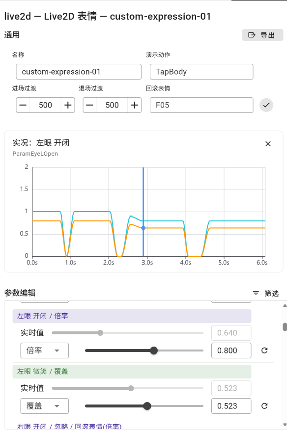

### 导出

在表情编辑器页点击“导出”按钮，弹出表情导出对话框。点选需要写入到表情文件中的参数，然后点击“导出”，浏览器将弹出对应的.exp.json/.exp3.json格式表情文件的下载请求。

对于忽略类型的、且未受回滚表情覆盖的参数，即便点选了导出，也不会真正被写入到生成的表情文件之中。

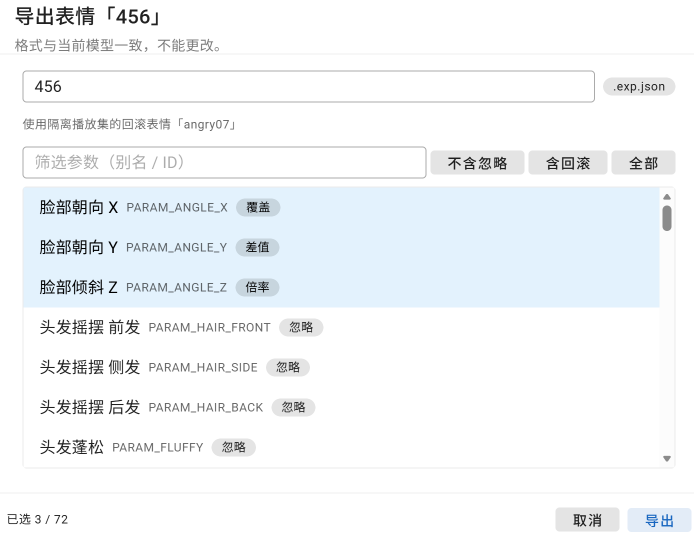